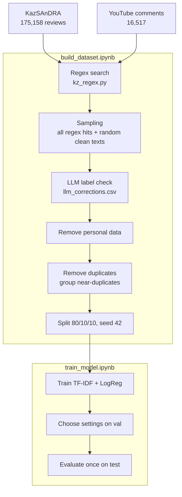
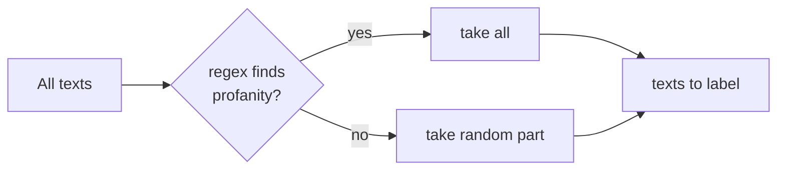
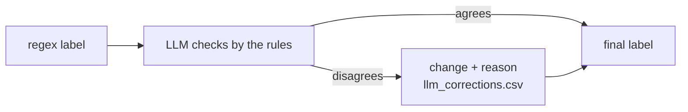
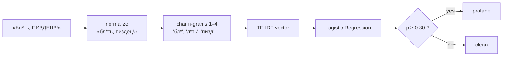

# Kazakh Profanity Detection

Finds profanity in Kazakh and Kazakh–Russian reviews and comments.

> ⚠️ Data and examples contain obscene words.

## Pipeline



## Files

```
kz_regex.py            regex word list + text normalizer
build_dataset.ipynb    builds data/
train_model.ipynb      trains and evaluates the model
llm_corrections.csv    label changes with reasons
youtube_collect.py     downloads YouTube comments
comments.jsonl         raw YouTube comments
data/                  train.csv, val.csv, test.csv
model/                 profanity_model.joblib, config.json
```

Run: `pip install -r requirements.txt` → `build_dataset.ipynb` → `train_model.ipynb`.

---

## 1. Dataset

| source | what | count |
|---|---|---|
| KazSAnDRA | Kazakh reviews of apps, goods, places, books ([GitHub](https://github.com/IS2AI/KazSAnDRA), CC BY 4.0) | 4,223 |
| YouTube | comments under Kazakh product-review videos (YouTube Data API, `youtube_collect.py`) | 801 |

No synthetic examples. Profanity is rare (~1%), so I took **all** regex hits plus random clean texts
(including 1,000 clean 1–2 star reviews, because a negative review is not automatically profane).



### Labeling rules

`1` = has at least one obscene/vulgar word, `0` = no.

| case | label | example |
|---|---|---|
| Russian or Kazakh obscene word | 1 | «Пиздес ойын екен», «Қотақбас» |
| Masked word | 1 | «п*здец», «с*гейін», «шшс» |
| Latin / misspelled | 1 | «pizdes», «котак», «бляяя» |
| Negative review, no obscene words | 0 | «Сапасы өте нашар» |
| Insult only | 0 | «Мал ойын» |
| Euphemism | 0 | «Блин», «капец» |
| Talking about swearing | 0 | «Боқтау көп» |

Mixed language doesn't matter: a Russian obscene word in a Kazakh text → 1. Texts fully in another language were removed.
Ambiguous words are decided by context; 7 unclear texts were removed.

### How labels were made



Regex **v1** labeled KazSAnDRA. Words it missed (зайбал, наху, шшс …) went into **v2**, used for YouTube.
KazSAnDRA stars were **not** used as labels: 662 five-star reviews are profane, 1,268 one/two-star reviews are clean.

### Splits

Exact duplicates removed. Near-duplicates and comments from the same YouTube video stay in one split.
`StratifiedGroupKFold`, seed 42, same share of profanity in each split.

| split | clean | profane | total |
|---|---|---|---|
| train | 2,605 | 1,416 | 4,021 |
| val | 325 | 177 | 502 |
| test | 325 | 176 | 501 |

Phones, e-mails, @users and names are replaced with `<PHONE>`, `<EMAIL>`, `<USER>`, `<NAME>`.
YouTube API terms limit storing comment text to 30 days — for a public repo keep only IDs + labels.

---

## 2. Model

**TF-IDF on character n-grams + Logistic Regression.** Profanity is written with typos, masks and latin letters;
character n-grams catch shared parts of these words. The dataset is small, so a simple model trains fast and is easy to explain.



- **Normalize** (`kz_regex.normalize`): lowercase, latin look-alikes → cyrillic, `@0 3 $` → `а о з с`, `бляяя` → `бля`.
- **Punctuation** is kept: `*` in `п*здец` is part of an n-gram and helps with masks.
- **Unknown words** still split into known n-grams; unseen n-grams are ignored.
- **Long texts** are not cut; any length gives one vector.
- Vocabulary is fitted on **train only**.

| setting | value |
|---|---|
| features | `TfidfVectorizer(analyzer="char_wb", ngram_range=(1,4), min_df=2, sublinear_tf=True)` |
| classifier | `LogisticRegression(C=100, max_iter=3000)` |
| threshold | 0.30 |
| seed | 42 |
| libraries | scikit-learn 1.9.1, numpy 2.5.3, pandas 3.0.5 |

Settings and threshold were chosen by F1 on **val** (grid: n-grams × C × class weight). Val F1 = 0.966.
Saved: `model/profanity_model.joblib` (normalizer + vocabulary + classifier) and `model/config.json` (threshold, settings, versions).

```python
clf = joblib.load("model/profanity_model.joblib")
p = clf.predict_proba(["Пиздес ойын екен"])[:, 1]  # profane if p >= 0.30
```

---

## 3. Results (test, evaluated once)

**501 examples, 176 profane. Precision 0.926 · Recall 0.926 · F1 0.926**

| | predicted clean | predicted profane |
|---|---|---|
| **clean** | 312 | 13 (FP) |
| **profane** | 13 (FN) | 163 |

| test part | model F1 | regex v1 F1 |
|---|---|---|
| KazSAnDRA (425) | 0.934 | 0.969 |
| YouTube (76) | **0.778** | 0.588 |

On KazSAnDRA regex wins because the labels were made from that regex. On new YouTube data the model is better
(only 10 profane comments there, so it's noisy). Long texts are harder: F1 0.96 for ≤ 50 chars, 0.75 for > 150.

### FP and FN

- **FP** — a clean review is hidden. Usually an honest angry review → looks like censorship.
- **FN** — profanity gets published and everyone sees it.

For auto-delete FP is worse; for sending to a moderator FN is worse. Practical setup:
`p ≥ 0.9` hide, `0.3–0.9` moderator, `< 0.3` publish.

### Mistakes

1. **Long text:** one bad word at the end of a long complaint («… сіктіңдер.») → p = 0.04. The vector is normalized by length, so one word gets lost.
2. **Masks:** «п*зду … с*гейін» → p = 0.07. `*` breaks the known n-grams.
3. **Similar normal words:** «көтердіде» (picked up the phone) looks like «көт», «есігі» (door) contains «сіг».
4. **Rude ≠ profane:** «мал … ешак» is flagged — insults often appear next to profanity in train.
5. **Label errors found by the model:** «п а ш о л н а х у» and «зблар» are labeled 0 but are profane. Labels were not changed after seeing predictions.

### Improvements

- Add masked examples to train (replace letters with `*`), add more rare forms.
- Score long reviews sentence by sentence.
- Use two thresholds + a human for the grey zone.

### Limitations

Labels checked by an LLM, not fully by people. Sampling used regex. Most profanity comes from app reviews. YouTube part is small.
